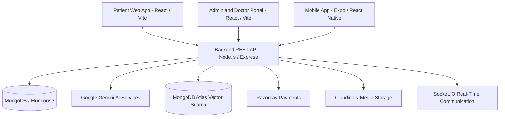
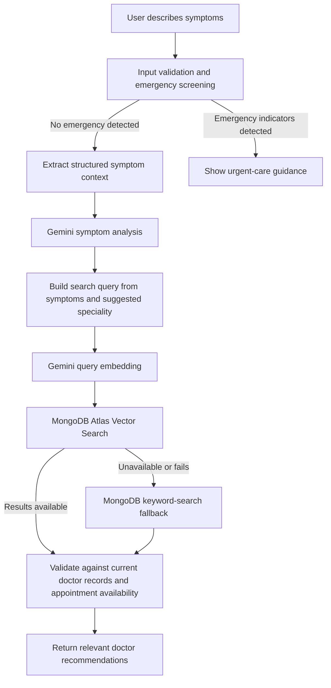

<!--
PUBLIC SHOWCASE NOTICE
This repository is a public-facing showcase of Click2Clinic. It summarizes the product,
architecture, technology stack, RAG workflow, and planned improvements. It is not the
application's source-code repository and intentionally excludes private implementation
details, deployment secrets, credentials, and sensitive configuration.
-->

# Click2Clinic

**A multi-platform healthcare management platform with AI-assisted symptom guidance and RAG-based doctor recommendations.**

Click2Clinic brings patient services, doctor workflows, laboratory bookings, pharmacy commerce, and administration into one connected digital healthcare experience.

> **Public showcase:** This repository presents Click2Clinic for portfolio and evaluation purposes. It is an overview of the project, not the complete application source code(intentionally excluded).

The project includes a patient-facing web application, an administration and doctor portal, a mobile client, and a backend API.

## Key Features

- **Doctor discovery and appointments** — Browse doctors and specialities, explore availability, and access appointment workflows.
- **Laboratory services** — Browse and book diagnostic tests.
- **Pharmacy workflows** — Explore medicines and manage cart, checkout, and order history.
- **Consultation and communication** — Support consultation workflows and real-time communication.
- **AI health assistant** — Collect symptom context and provide cautious, non-diagnostic health guidance.
- **Doctor and administration tools** — Manage doctor profiles, schedules, appointments, inventory, and platform operations.
- **Multi-platform access** — Patient web portal, admin/doctor portal, and Expo-based mobile application.

## System Architecture

The clients communicate with a shared backend API. The backend coordinates authentication, healthcare workflows, persistence, AI services, payments, media handling, and real-time communication.

## RAG Architecture: Doctor Recommendations

Click2Clinic uses a Retrieval-Augmented Generation (RAG) workflow to connect symptom-related conversations with doctor records maintained by the platform.

### How it works

1. **Safety screening:** The backend checks incoming messages for configured emergency-related phrases before continuing through the standard flow.
2. **Symptom extraction:** The chatbot extracts structured details such as symptoms, duration, severity, affected body area, and appointment preferences when provided.
3. **AI analysis:** Google Gemini generates a preliminary assessment, possible conditions, precautions, and a suggested medical speciality. This is informational guidance, not a diagnosis.
4. **Embedding and retrieval:** Doctor profiles are represented as embeddings. The user's search query is embedded and compared against doctor-profile vectors using MongoDB Atlas Vector Search.
5. **Live-data validation:** Retrieved candidates are checked against current doctor records. When a date is requested, the workflow can filter for bookable slots rather than relying solely on stored embedding data.
6. **Fallback retrieval:** If vector retrieval is unavailable or fails, the backend can fall back to MongoDB keyword matching.
7. **Recommendations:** The assistant returns relevant doctor information to support the next step in the appointment journey.

**Important distinction:** RAG is used here for retrieving relevant doctor profiles; it does not by itself establish a medical diagnosis. The current code uses Google Gemini for symptom analysis and embeddings. A future Hugging Face-first, system-based disease-assessment comparison is a planned direction, not a claim about the current implementation.

## Technology Stack

| Area | Technologies |
| --- | --- |
| Patient Web | React 19, Vite, React Router, Tailwind CSS |
| Admin and Doctor Portal | React, Vite |
| Mobile | Expo, React Native, React Navigation |
| Backend | Node.js, Express |
| Database | MongoDB, Mongoose |
| AI and RAG | Google Gemini, Gemini Embeddings, MongoDB Atlas Vector Search |
| Authentication | JWT, bcrypt |
| Real-time Communication | Socket.IO |
| Payments | Razorpay |
| Media and Uploads | Cloudinary, Multer |
| Maps and Location | Leaflet, React Leaflet |

## Future Scope

The following items are planned enhancements and are not represented as completed features.

- **Expanded symptom intelligence** — Collect and structure a broader range of symptoms and context, including duration, severity, affected body area, and related symptoms.
- **Dual-path disease assessment** — Explore a Hugging Face-first assessment followed by a separate system-based assessment. Compare outputs and treat agreement as supporting evidence for further review, not as proof of a disease.
- **Broader disease and speciality coverage** — Expand the supported medical knowledge base across respiratory medicine, cardiology, endocrinology, gastroenterology, neurology, dermatology, orthopedics, mental health, pediatrics, and additional specialities.
- **AI-assisted e-pharmacy** — Explore prescription-aware medicine discovery and cart assistance with appropriate safety and professional oversight.
- **Smart wallet and automated refunds** — Extend payment workflows with wallet functionality and automated refund handling.
- **Wearable and health-data integration** — Explore integrations with Apple Health, Google Fit, or Fitbit so users can choose to share relevant health metrics with authorized healthcare professionals, subject to consent and privacy safeguards.

## Deployment

- **Live Patient Website:** [Click2Clinic](http://click2clinic.me/)

## Responsible Use and Security

- The AI assistant provides informational support and is not a substitute for professional medical advice, diagnosis, or treatment.
- Users with possible emergency symptoms should seek local emergency assistance rather than relying on a chatbot.
- Real deployments should protect health information, restrict access by role, secure secrets, validate payment flows, and apply appropriate privacy and compliance controls.
- Do not place API keys, environment files, patient records, or private configuration in this public showcase.

## Project Status

Click2Clinic is under active development. Feature availability depends on the current deployment and configuration. Future-scope items may change as the project evolves.
